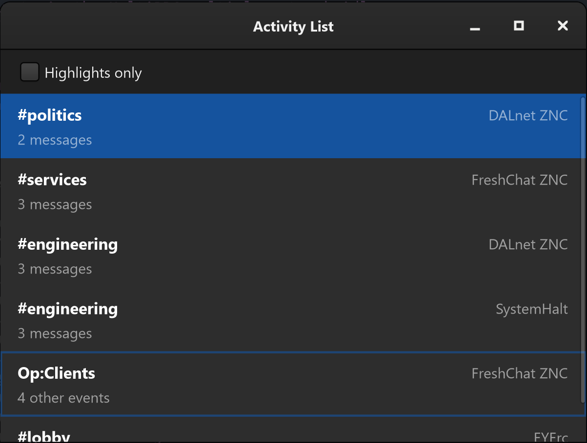
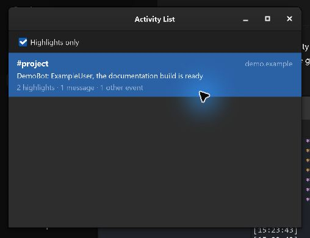
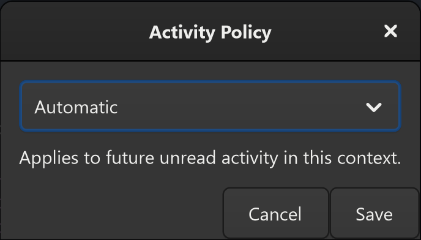
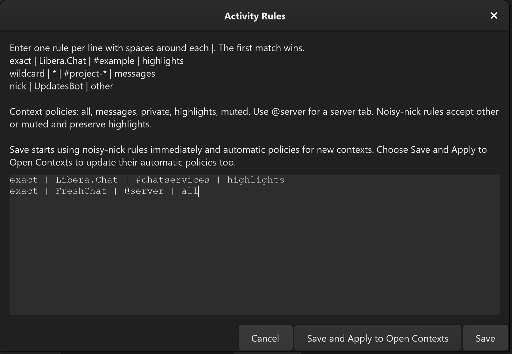

# Main Window

The main-window screenshot shows the installed client. Live portable
testing covered the 1.0.8 Activity List and name limits. The
[release roadmap](../../To-Do.md#108-release) records the installer checks.

Fabulor keeps each IRC network, server tab, channel, and private conversation
in a single main window by default. The layout can be adjusted without losing
the connection or closing the selected conversation.

## Window Layout

The normal tree layout contains:

- the menu bar across the top;
- the channel switcher at the left;
- the topic bar above the transcript;
- the transcript in the centre;
- the user list beside channel transcripts; and
- the nickname box and input box along the bottom.

Some items are meaningful only in a channel. A server tab has no channel user
list, and a private conversation does not have channel mode controls.


Use **View** to show or hide the menu bar, topic bar, user list, and user-list
buttons. Channel mode controls are always available from the compact
**Modes** menu at the right of a channel topic. **View > Channel Switcher**
changes between the tree and tab layouts. **View > Fullscreen** enters or
leaves full-screen mode.

If the menu bar has been hidden, press `Ctrl+F9` to show it again.

## Channel Switcher

The channel switcher identifies every open network context:

- a server entry owns the connection messages for one network;
- channels appear beneath their server in tree mode; and
- private conversations appear as separate entries.

Select an entry to show its transcript. In tree mode, use the arrow beside a
server to collapse or expand its children. Closing a channel entry parts the
channel when appropriate; closing a server entry can close the connection and
its child contexts.

Right-click an entry for context-specific commands such as auto-connect,
autojoin, detach, or close. The exact choices depend on whether the entry is a
server, channel, or private conversation.

The switcher uses text, icons and theme colours to distinguish selected and
unread entries. In 1.0.8, the tree and tabs show unread counts. Counts above
999 appear as `999+`. A collapsed network entry includes unread activity
from its channels and private conversations. Opening the server tab clears
its own activity. Open or mark the individual rows as read to clear theirs.

Tree rows use compact, consistently aligned icons and spacing. Network headings
use a restrained semibold weight. Long channel names remain shortened; hover
over one to see its full name.

The channel-switcher layout can be configured under **Settings > Preferences
> Interface > Channel switcher**. Available settings include placement,
sorting, icons, label length, close buttons, mouse-wheel switching, and whether
new channels, private conversations, and utility views open as tabs or
windows.

From 1.0.8, **Channel name limit** applies to the tree and tabs, and
**Nickname limit** applies to sender names in live transcript events and
to the user list. New profiles start at 16 characters for each setting.
Set either one to 0 to use available-width clipping alone. Restart Fabulor
after changing the limits. Hover over a shortened name to see it in full.

## Activity List

In 1.0.8, **View > Activity List** shows one row per unread server tab,
channel or private conversation. The list sorts by activity priority and
then by recency. The selected context can accumulate unread activity while
its window is out of focus, minimised or in the tray.



Turn on **Highlights only** to show rows with an unread highlight. Hidden
rows continue accumulating unread counts. Double-click a row or select it
and press `Enter` to open it. Right-click a row or press `Shift+F10` on the
selected row and choose **Mark as Read** to clear it without opening it.

Each highlighted row shows the sender and text of its latest unread
highlight. Hover over the preview to read more of a long line. Opening the
context or marking it as read clears the preview.



### Activity Policies And Rules

To choose which events count as unread, right-click a server, channel or
private conversation in the channel switcher and open **Settings > Activity
Policy**. **Automatic** uses the first matching rule or counts all activity
if no rule matches. An explicit choice overrides the automatic rule.



Open **Settings > Preferences > Interface > Channel switcher > Activity
Rules** to edit the rules. An exact context rule has four fields in this
order: `exact | network | context | policy`. Use spaces around each `|`.



```text
exact | FreshChat | @server | all
wildcard | * | @server | muted
exact | Libera.Chat | #announcements | highlights
wildcard | * | #project-* | messages
nick | UpdatesBot | muted
```

Use the Network List name, or the connection hostname for direct connections.
Put `@server` in the third field to target the server tab. The first two
rules together count all activity on the FreshChat server tab and mute
unread counts on other server tabs. Put exceptions above broader rules.
Ordinary server notices use the **Other** category even if they mention
your nickname.

Noisy-nick rules match an exact nickname across networks. Use `other` to
lower it to the lowest activity priority, or `muted` to omit its ordinary
events from unread counts. Both pass genuine highlights through the
context's policy. Activity rules leave transcript messages, logs and alerts
intact.

**Save** updates noisy-nick rules immediately and uses automatic policies for
new contexts. Choose **Save and Apply to Open Contexts** to update automatic
policies in open contexts too. Changes affect future events. The rules file
supports up to 64 context rules and 128 noisy-nick rules, within 32 KiB total.
Use `/ACTIVITY` in an open tab to check its effective policy. For example,
`auto (muted)` means the tab is following an automatic mute rule.

## Server Tabs

Every connection has a server tab. It displays lookup, connection, TLS,
authentication, capability, message-of-the-day, service, and error output.
Fast bouncer connections may enter an autojoined channel quickly, but the
complete connection output remains in the server tab.

Consult the server tab before retrying a failed connection or reporting a
connection problem. Its output often separates DNS, proxy, TLS, SASL, and IRC
service failures without additional diagnostic tools.

## Topic Bar

In a channel, the topic bar displays the current topic. It can use one or
multiple lines according to **Settings > Preferences > Interface >
Appearance > Allow multi-line topics**.

Channel operators can edit the topic by activating the topic field, changing
the text, and pressing `Enter`. If the server does not permit the change, its
response appears in the transcript or server tab.

Recognised links in topics and transcripts use the same Windows browser
handling as other Fabulor links.

## Transcript

The transcript contains messages and events for the selected context. It may
show timestamps, nicknames, IRC formatting, links, emoji, flags, and a marker
line. Its font, timestamps, indentation, colours, scroll speed, background,
and marker visibility are configured in Preferences.

Use the mouse wheel, `Page Up`, and `Page Down` to read earlier or later text.
`Ctrl+Home` moves to the top and `Ctrl+End` returns to the bottom. When the
transcript is above the newest message, the down-chevron overlay returns
directly to the bottom.

The marker line records the boundary between previously read and newer text.
Use **Window > Move to Marker Line** to find it and **Window > Reset Marker
Line** to remove the current marker.

The **Window** menu also provides transcript commands:

- **Copy Selection** copies the current selection;
- **Clear Text** clears the visible transcript without deleting its saved log;
- **Save Text...** writes the current transcript to a file; and
- **Search** finds text and moves between matches.

Clearing a transcript is not the same as clearing saved conversation logs.
See [Input History And Conversation Logs](history-and-logs.md) for persistent
data and clearing commands.

## Selecting And Copying Text

Drag from the first required character to the last required character. The
highlight follows the exact partial or complete text selection, including
wrapped lines.

By default, releasing the left mouse button copies selected text to the
Windows clipboard. If automatic copying is disabled, use `Ctrl+Shift+C` or
**Window > Copy Selection**.

The options under **Settings > Preferences > Chatting > Advanced** control
copying:

- **Automatically copy selected text** copies on button release;
- **Automatically include timestamps** includes displayed timestamps; and
- **Automatically include color information** preserves IRC colour data.

When automatic timestamp copying is disabled, hold `Shift` while selecting to
include timestamps. When automatic colour copying is disabled, hold `Ctrl`
while selecting to include colour information.

## Links

Move the pointer over a recognised link in the transcript. The pointer changes
to indicate that the link is actionable.

- Left-click once to open the link in the default Windows browser.
- Right-click and select **Open Link in Browser** for the explicit menu action.
- Select **Copy Selected Link** to copy the link without opening it.

Only open links from people and networks you trust. A displayed link can lead
to content outside Fabulor, and the destination is handled by the default
Windows application.

## Input Box

Type a message in the input box and press `Enter` to send it to the selected
channel or private conversation. A line beginning with `/` is interpreted as
a command.

The input box supports:

- `Up` and `Down` for previous and later entries in that context's history;
- `Tab` and `Shift+Tab` for nickname or command completion;
- normal Windows text selection, editing, and clipboard operations;
- IRC formatting controls inserted by configured keyboard shortcuts;
- spell checking and replacement suggestions; and
- emoji and flag insertion from the icon at the right.

Saved input history is network- and context-aware. A command entered in one
channel does not become the active history of an unrelated network or channel.

The nickname box identifies the nickname used by the current connection. Its
mode icon reflects the user's current IRC status where available. Both can be
shown or hidden in **Settings > Preferences > Interface > Input box**.

## Spell Checking

When spell checking is enabled, misspelled words are underlined in the input
box. Right-click a word to see suggestions, replace it, ignore it for the
current session, or add it to the personal dictionary. Personal dictionary
entries persist across normal restarts.

Links are excluded from ordinary spelling-word handling. Spell-checking
languages are selected under **Settings > Preferences > Interface > Input
box** using language codes separated by commas.

### Optional Auto-correct

The local v1.0.7 candidate adds **Auto-correct while typing** on that same
Preferences page. It is **off by default** and requires spell checking plus
an active English Windows/WinSpell dictionary (for example, `en_AU`). The
maintainer reported improved behaviour with this candidate on 2026-10-30;
that focused feedback does not establish every example, undo or platform check.

When enabled, type a misspelling such as `sleke` or `btter`, then press **Space**.
Fabulor uses the first available Windows spelling suggestion, in Windows' order,
through the bundled Enchant WinSpell provider. It no longer uses a fixed typo
list or a separate Fabulor ranking model. Every active dictionary must reject
the original, and the selected English Windows dictionary must accept the
replacement. If no suitable suggestion is available, the word stays unchanged.

Windows' preferred suggestion can be wrong: `btter` can mean “better” or
“butter”. Use immediate Backspace undo when it chooses the wrong word. Windows
controls the proposed spelling, case and diacritics; for example, the tested
`en_AU` checker offers `Türkiye` for `turkey`/`Turkey`. That is not a universal
Fabulor country-name substitution rule. Personal/session dictionary words and
known nicknames are left alone. A typo already accepted by Windows' custom dictionary is also left
alone, rather than overriding a deliberate dictionary entry.

The local follow-up fixes a WinSpell provider bug that could make session-only
ignores persistent in Windows. New session ignores stay local to Enchant's
dictionary lifetime; existing custom words are not automatically deleted.

Press **Backspace immediately** after a correction to restore the original
word and remove the triggering space. Pressing Space again does not instantly
reapply that correction. The special undo expires when you continue editing,
move the cursor, click, change tabs or leave the input box.

Only fully keyboard-typed, lower-case or initial-capital ASCII-letter tokens
(up to 64 letters) are eligible; replacements support Unicode and ordinary
multiword suggestions. Pasted/history text, links, email addresses, channel/mention
names, path/code-shaped tokens, acronyms, emoji and lines containing IRC
formatting controls are not automatically corrected. Slash-command lines and
lines beginning with the configured command character are excluded. Words
ending in punctuation are left for manual suggestions. Active input-method
composition is excluded; **Enter never triggers a correction**. Other languages
continue to use ordinary spell checking. No automatic corrections are saved as
learned word pairs.

## Emoji And Flags

In Fabulor 1.0.7, select the emoji icon at the right of the input
box or press `Ctrl+;` (also `Ctrl+.`) to open the same GTK emoji chooser. Use
its search box or category buttons, then select an item to insert it at the
cursor or replace selected text. Press `Escape` to dismiss the picker.
The chooser limits the height of its scrolling grid to suit the display.

The **Flags** category uses Fabulor's bundled colour-emoji font to display
country flags graphically and inserts their Unicode regional-indicator
sequences, not image data. GTK provides the search terms and catalogue; do not
assume every two-letter country code is a searchable alias. The preceding
custom picker and its bundled PNG artwork remain available in the source as a
fallback during local testing.

The appearance of inserted emoji and flags depends on the font and fallback
fonts available to the input box, transcript or receiving IRC client.

## User List

The user list shows people currently known to be in the selected channel.
Mode icons distinguish operators and other ranked users when supported by the
network. Nickname colours, sorting, hostnames, user counts, away tracking, and
placement are controlled under **Settings > Preferences > Interface > User
list**.

When a channel has no visible users, Fabulor shows a quiet placeholder in the
list area. The action footer and network meters remain available, and the
placeholder disappears as soon as the user list is populated.

Enable **Allow user list to resize with the window** to adjust the user-list
divider manually. Disable it to lock the divider to the
`gui_ulist_nick_width` setting while switching channels or resizing the main
window. The lock is reapplied after later layout changes so the divider cannot
occasionally drift until another channel is selected. Fabulor keeps the panel
at least 150 pixels wide so its two-column action footer and network meters
remain usable; larger configured widths are preserved.

Right-click a nickname to open its action menu. Depending on context and your
channel privileges, it can provide:

- a private conversation;
- file sending;
- WHOIS information;
- adding the nickname to the Friends List;
- ignore controls;
- channel-operator actions; and
- reply handling.

In the local v1.0.7 candidate, recognised DALnet connections also show
**DCC Permissions (DALnet)**:

- **Allow Files from This User** requests `/quote DCCALLOW +nickname`.
- **Revoke File Permission** requests `/quote DCCALLOW -nickname`.
- **Show DCC Allow List** requests `/quote DCCALLOW LIST`.

Recognition uses an exact configured DALnet name, a server-reported `dal.net`
hostname, or the server's advertised `NETWORK=DALnet` identity. This supports
renamed/bouncer connections when that identity is retained; a generic bouncer
that hides all those identifiers cannot be recognised automatically. Actions
stay bound to the menu's original live connection. Allow/revoke require one
nickname; list remains available with multiple selected users. Existing custom
menu entries are preserved. The maintainer accepted the installed feature as
working as expected on 2026-10-23.

These permissions allow a sender's otherwise-blocked file types; they do not
make an executable safe or change Fabulor's automatic file-acceptance settings.
DALnet clears your list on disconnect and removes an entry when that user
changes nickname or disconnects. No permission state is inferred or shown as a
checkmark. See [DALnet's DCCallow documentation](https://docs.dal.net/docs/misc.html#3).

The information submenu displays only information currently known to the IRC
client. Fields such as account, country, away message, and last-message time
may be absent or marked unknown until the network supplies them.

Double-click behaviour is configurable. Do not assume that double-clicking a
nickname always starts a private conversation on another user's installation.

## Menus

The main menus group commands by purpose:

- **Fabulor** opens the Network List, creates tabs or windows, loads a plugin
  or script, detaches or closes the current context, and quits;
- **View** controls the visible layout, switcher, network meters, and
  full-screen mode;
- **Server** disconnects or reconnects, joins a channel, opens the Channel
  List, and changes away state;
- **Settings** opens Preferences and the editors for replacements, CTCP
  replies, buttons, shortcuts, text events, URL handlers, and user commands;
- **Window** opens utility views and operates on the current transcript; and
- **Help** opens the manual, project information, issue reporting, and About
  dialog.

Add-ons may append commands to supported menus. An add-on command is not a
built-in Fabulor feature merely because it appears in a standard menu.

## Utility Windows

The **Window** menu opens the Ban List, Character Chart, Direct Chat, File
Transfers, Friends List, Ignore List, Plugins and Scripts, Raw Log, and URL
Grabber. Some utilities require a connected server or selected channel and are
unavailable when their context does not exist.

The Ban List and Ignore List are independently resizable. Fabulor saves each
window's size when a manual resize finishes and restores that size when the
window is opened again, including after a client restart. Opening an empty or
populated list does not replace the saved dimensions. The corresponding
`gui_banlist_width`, `gui_banlist_height`, `gui_ignore_width`, and
`gui_ignore_height` settings may also be changed with `/SET`.

See [Add-ons](addons.md) before loading, reloading, or removing executable
plugins and scripts.

The Raw Log displays protocol traffic for the selected server and can contain
sensitive connection information. Review it before sharing a screenshot or
bug report.

## System Tray

Tray behaviour is configured under **Settings > Preferences > Chatting >
Alerts**. The available options enable the tray icon, minimize to the tray,
close to the tray, and automatically mark connections away or back when the
window is hidden or restored.

On Windows, left-click the tray icon to hide or restore the main window.
Right-click it for **Restore Window** or **Hide Window**, **Away**, **Back**,
**Preferences**, and **Quit**. Use **Quit** when you intend to end Fabulor;
closing or minimizing may leave it connected in the notification area.

Tray notifications and icon changes can indicate private messages,
highlights, channel messages, invitations, and file offers according to the
alert settings.

## Default Keyboard Shortcuts

The following defaults are useful for main-window navigation:

| Shortcut | Action |
| --- | --- |
| `Ctrl+Page Up` / `Ctrl+Page Down` | Select the previous or next context |
| `Alt+1` through `Alt+9` | Select a numbered context |
| `Page Up` / `Page Down` | Scroll the transcript |
| `Ctrl+Home` / `Ctrl+End` | Move to the top or bottom of the transcript |
| `Up` / `Down` | Move through input history |
| `Tab` / `Shift+Tab` | Complete a nickname or command |
| `Ctrl+S` | Open the Network List |
| `Ctrl+W` | Close the current context |
| `F7` | Show or hide the user list |
| `Ctrl+F9` | Show or hide the menu bar |
| `F11` | Enter or leave full-screen mode |
| `Alt+A` | Toggle away status |
| `Ctrl+M` | Reset the marker line |
| `Ctrl+Shift+M` | Move to the marker line |
| `Ctrl+Shift+C` | Copy the transcript selection |
| `Ctrl+F` | Search the transcript |
| `Ctrl+G` / `Ctrl+Shift+G` | Find the next or previous match |
| `Ctrl+Shift+T` | Reopen the most recently closed channel tab |
| `F1` | Open the manual |

`Ctrl+Q` quits only when **Enable Ctrl+Q to quit** is enabled under
**Settings > Preferences > Chatting > General**.

Shortcuts can be inspected and changed under **Settings > Keyboard
Shortcuts**. A customised installation may therefore differ from this table.

## Keyboard And Accessibility

Use `Tab` and `Shift+Tab` to move among interactive controls, arrow keys to
move within lists and menus, `Enter` or `Space` to activate the focused item,
and `Escape` to close a menu or popover. Standard Windows focus indicators
show the current keyboard target according to the active GTK4 desktop theme.

Fabulor exposes labels for primary controls, menu commands, list entries, and
emoji actions. In 1.0.8, Activity List rows also expose the network, context,
unread counts, priority and any highlight preview to assistive technology.
Final installed keyboard and accessibility verification is pending.

## If The Layout Looks Wrong

- Confirm the intended context is selected in the channel switcher.
- Restore hidden sections from **View**.
- Check switcher and user-list placement in Preferences.
- Disable automatic user-list resizing if its divider moves unexpectedly.
- Return the desktop theme to **System default** to distinguish theme CSS from
  a layout problem.
- Close the emoji picker with its close button or `Escape` before testing
  unrelated keyboard focus.
- Record the affected network and channel type, but remove private transcript
  content before taking a diagnostic screenshot.
